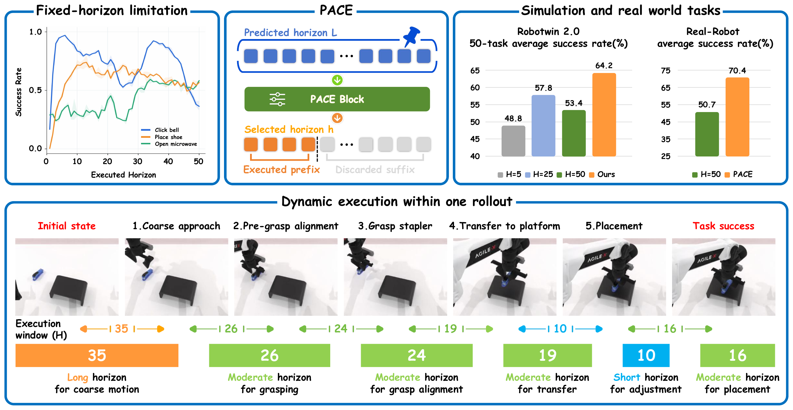

<h1 align="center">PACE: Phase-Aware Chunk Execution<br>for Robot Policies with Action Chunking</h1>

<h3 align="center">NeurIPS 2026</h3>

<p align="center">
  <a href="https://huggingface.co/niejunnan25/pi05-robotwin"></a>
  <a href="https://niejunnan25.github.io/pace-project/"></a>
  <a href="https://huggingface.co/niejunnan25/pi05-robotwin"></a>
</p>

<p align="center">
  <a href="pace/media/overview.pdf"></a>
</p>

PACE selects how many actions to execute from each predicted chunk before querying the policy again. It uses changes in joint motion and requires no additional policy training; task thresholds are calibrated from demonstrations.

We release the standalone PACE module, calibrated thresholds for all 50 RoboTwin tasks, and evaluation code for π₀.₅, including Fixed H=5/25/50 baselines and multi-GPU evaluation.

<p align="center">
  <a href="#install-and-try-the-core">Using PACE</a> ·
  <a href="#prepare-environments-and-models">RoboTwin evaluation</a> ·
  <a href="#citation">Citation</a>
</p>

<a id="install-and-try-the-core"></a>

## 🧩 Using PACE

The standalone module runs in your policy or benchmark environment without RoboTwin or OpenPI.

### Installation

Fetch `pace/` with a Git sparse checkout:

```bash
git clone --depth 1 --filter=blob:none --sparse \
  https://github.com/niejunnan25/PACE.git pace-source
git -C pace-source sparse-checkout set pace
```

Install it with Python 3.10–3.12:

```bash
cd pace-source/pace
python -m pip install -e .
```

The included example uses synthetic actions and an example threshold:

```bash
python scripts/example.py
```

<a id="integrate-pace"></a>

### Usage

PACE runs between policy inference and action execution:

```python
from pace import select_horizon

obs = env.get_observation()
actions = policy.infer(obs)  # Decoded joint commands, shape (50, 14).

horizon = select_horizon(actions, threshold)

for action in actions[:horizon]:
    env.step(action)
```

`actions` is the sequence predicted by the policy, with shape `(T, D)`: `T` future control steps and `D` joint and gripper command values per step. In this example, `policy.infer` includes decoding and denormalization, so PACE receives absolute joint targets. The defaults match RoboTwin's 50 Hz control sequence and `(50, 14)` action chunks. Calibrate `threshold` once per task from demonstrations and reuse it during evaluation.

<details>
<summary>Threshold calibration</summary>

Pass each demonstration as an array of absolute joint positions. This example uses RoboTwin's joint layout at 50 Hz:

```python
from pace.calibration import calibrate

# demonstrations: an iterable of (time, 14) joint-position arrays.
threshold = calibrate(demonstrations)["threshold"]
```

Calibration accepts these arrays directly; no LeRobot conversion is needed. Use the same joint layout and sampling frequency for calibration and evaluation.

</details>

<details>
<summary>Other robots and action layouts</summary>

For a 7-joint arm with one gripper at 20 Hz:

```python
from pace import PaceConfig, select_horizon
from pace.calibration import calibrate

config = PaceConfig(fps=20)
arms = (slice(0, 7),)  # Seven joint channels; exclude the gripper.

# Calibrate once from this task's (time, 8) demonstration arrays.
threshold = calibrate(demonstrations, config=config, arms=arms)["threshold"]

# After each prediction: actions are decoded joint commands, shape (T, 8).
horizon = select_horizon(
    actions,
    threshold,
    config=config,
    arms=arms,
    max_horizon=len(actions),
)
```

- `fps`: sampling frequency of the joint sequence.
- `arms`: one joint-channel slice per arm, excluding grippers.
- `max_horizon`: maximum number of actions to execute. Set it to `len(actions)` to allow the full chunk, including chunks longer than 50 steps.

Use the same joint units and settings for calibration and selection. The selector measures motion in absolute joint positions; end-effector poses or Cartesian increments need a different motion signal before they can be used here.

RoboTwin's default joint layout is:

```text
[left arm (6), left gripper (1), right arm (6), right gripper (1)]
```

</details>

<a id="prepare-environments-and-models"></a>
<a id="environments"></a>

## 🤖 RoboTwin evaluation

We provide [calibrated thresholds](pace/configs/calibration) and evaluation scripts for all 50 RoboTwin tasks, with π₀.₅ policies served by [OpenPI-PACE](https://github.com/niejunnan25/Openpi-PACE). The integration uses RoboTwin 2.0's `stable_2.0` interface ([base revision](https://github.com/RoboTwin-Platform/RoboTwin/tree/13c3c47ff4312dd62484bcd51be034af55c062d1)).

### Environment setup

If RoboTwin already runs in your workspace, keep its environment and assets. Copy `pace/` into that workspace:

```bash
git clone --depth 1 --filter=blob:none --sparse \
  https://github.com/niejunnan25/PACE.git pace-source
git -C pace-source sparse-checkout set pace
cp -R pace-source/pace /path/to/RoboTwin/
```

If you already have this repository cloned, copy its `pace/` directory directly.

<a id="new-robotwin"></a>

<details>
<summary>Installing RoboTwin from scratch</summary>

Prepare drivers, Vulkan, and other system dependencies using the [official RoboTwin guide](https://robotwin-platform.github.io/doc/usage/robotwin-install.html). This repository includes the RoboTwin source and `pace/`; the commands below create a new workspace and Conda environment, then install the dependencies and assets:

```bash
git clone https://github.com/niejunnan25/PACE.git
cd PACE

conda create -n RoboTwin python=3.10 -y
conda activate RoboTwin

bash script/_install.sh
bash script/_download_assets.sh
```

</details>

<a id="install-pace-client"></a>

Install PACE in the **RoboTwin Conda environment**:

```bash
conda activate RoboTwin
cd /path/to/RoboTwin

python -m pip install -e './pace[robotwin]'
```

<a id="prepare-model-service"></a>

### Model setup

If you already use OpenPI, apply the [RoboTwin integration patch](https://github.com/niejunnan25/Openpi-PACE/blob/main/pace/patches/openpi-robotwin.patch). It adds the 50 task configurations and model-serving adaptations for RoboTwin:

```bash
cd /path/to/openpi
source .venv/bin/activate

curl -fL \
  https://raw.githubusercontent.com/niejunnan25/Openpi-PACE/main/pace/patches/openpi-robotwin.patch \
  -o /tmp/openpi-robotwin.patch

git apply --check /tmp/openpi-robotwin.patch && \
  git apply /tmp/openpi-robotwin.patch
uv pip install --no-deps -e .
```

OpenPI-PACE already includes this patch.

<a id="new-openpi"></a>

<details>
<summary>Installing OpenPI-PACE from scratch</summary>

OpenPI-PACE requires Python 3.11 or newer and uses [uv](https://docs.astral.sh/uv/getting-started/installation/) for dependencies. With uv installed, open a new terminal and place OpenPI-PACE next to your RoboTwin workspace:

```bash
cd /path/to
git clone https://github.com/niejunnan25/Openpi-PACE.git OpenPI-PACE
cd OpenPI-PACE

git submodule update --init --recursive
GIT_LFS_SKIP_SMUDGE=1 uv sync
GIT_LFS_SKIP_SMUDGE=1 uv pip install -e .

source .venv/bin/activate
```

The model server uses this `.venv`, while simulation runs in the RoboTwin Conda environment.

</details>

<a id="assets-and-checkpoints"></a>

#### Checkpoints

Activate the model environment in your OpenPI workspace. Download the `adjust_bottle` checkpoint and shared tokenizer from [Hugging Face](https://huggingface.co/niejunnan25/pi05-robotwin):

```bash
huggingface-cli download niejunnan25/pi05-robotwin \
  --include "adjust_bottle/*" tokenizer.model manifest.json TERMS.md NOTICE \
  --local-dir local/pi05-robotwin
```

Each task checkpoint is about 12.4 GB. Replace `adjust_bottle/*` to download another task, or reuse an existing copy. A single-task evaluation needs one checkpoint; the full evaluation needs all 50. Keep each task's weights and matching normalization statistics together:

```text
local/pi05-robotwin/adjust_bottle/
  params/
  assets/robotwin/norm_stats.json
```

If the tokenizer is not already in OpenPI's default cache, copy it there:

```bash
mkdir -p ~/.cache/openpi/big_vision
cp local/pi05-robotwin/tokenizer.model ~/.cache/openpi/big_vision/paligemma_tokenizer.model
```

The released checkpoints are ready for evaluation, with no training demonstrations, parameter conversion, or recalibration needed. Custom checkpoint and cache locations are covered in the [OpenPI-PACE guide](https://github.com/niejunnan25/Openpi-PACE/blob/main/README.md#download-a-checkpoint).

Back in your **RoboTwin terminal**, install the client that connects to the model server:

```bash
conda activate RoboTwin
cd /path/to/RoboTwin

python -m pip install -e /path/to/openpi/packages/openpi-client
```

<a id="evaluate-on-robotwin"></a>

### Evaluation

<a id="evaluate-one-task"></a>

#### Single task

For `adjust_bottle`, run the model server and simulation client in separate terminals.

**Terminal 1: OpenPI model server**

```bash
cd /path/to/openpi
source .venv/bin/activate

CUDA_VISIBLE_DEVICES=0 XLA_PYTHON_CLIENT_MEM_FRACTION=0.2 \
python scripts/serve_policy.py --port 8000 policy:checkpoint \
  --policy.config pi05_robotwin_adjust_bottle \
  --policy.dir local/pi05-robotwin/adjust_bottle
```

**Terminal 2: RoboTwin evaluation**

```bash
conda activate RoboTwin
cd /path/to/RoboTwin

python pace/scripts/evaluate.py \
  --task adjust_bottle --method pace --gpu 0 --seed 0 --port 8000
```

Each run evaluates 100 episodes, with seeds 0, 1, and 2 supported. The task and port must match in both terminals. `--gpu` selects the simulation GPU; `CUDA_VISIBLE_DEVICES` selects the model GPU.

The first inference may take longer due to XLA compilation. Stop the server with Ctrl-C after each run and start a fresh server for the next one.

For Fixed H=25, use this client command:

```bash
python pace/scripts/evaluate.py \
  --task adjust_bottle --method fixed --horizon 25 --gpu 0 --seed 0 --port 8000
```

Fixed accepts `--horizon` from 1 to 50. PACE uses the released thresholds and does not take this argument.

<a id="evaluate-multiple-tasks"></a>

#### ⚡ All 50 tasks

The batch script manages the model servers and simulation clients across multiple GPUs. Each invocation evaluates 100 episodes per task: 5,000 episodes across 50 tasks for one seed.

Prepare all 50 checkpoints and edit [`pace/scripts/eval.yaml`](pace/scripts/eval.yaml). Its defaults assume OpenPI and RoboTwin are in sibling directories. For other locations:

```yaml
openpi_root: /home/user/OpenPI-PACE
checkpoint_root: /data/checkpoints/pi05-robotwin
server_python: .venv/bin/python
```

`openpi_root` points to the OpenPI workspace, and `checkpoint_root` to the directory containing task folders such as `adjust_bottle/`. `server_python` is relative to the OpenPI workspace, or can be an absolute interpreter path.

Run from the RoboTwin workspace with its Conda environment active. The defaults are PACE, seed 0, and online expert screening: the expert checks candidate scenes, and accepted scenes are reset for policy evaluation.

**PACE:**

```bash
bash pace/scripts/eval_all.sh --method pace --seed 0
```

**Fixed H=25:**

```bash
bash pace/scripts/eval_all.sh --method fixed --horizon 25 --seed 0
```

Fixed requires `--horizon` (1–50); PACE selects the execution horizon automatically.

Add `--ultrafast` to either command to skip repeated expert screening and use the bundled scene cache:

```bash
# PACE
bash pace/scripts/eval_all.sh --method pace --seed 0 --ultrafast

# Fixed H=25
bash pace/scripts/eval_all.sh --method fixed --horizon 25 --seed 0 --ultrafast
```

[`pace/configs/expert_scenes.json`](pace/configs/expert_scenes.json) contains 100 expert-accepted scenes per task for seeds 0, 1, and 2, in their original screening order. Each scene is reset before the model runs; all 5,000 policy episodes are still evaluated. The same flag works with `evaluate.py` and Fixed baselines.

This mode uses a fixed scene list. Online expert screening can accept different scenes across runs, so use the same cache when comparing policies. Results record the evaluation mode and cache hash.

The default is 8 GPUs with 3 evaluations per GPU. Run `bash pace/scripts/eval_all.sh --help` for GPU selection and other options.

For three repetitions, run the same command three times. Each invocation saves its results separately.

<a id="read-the-results"></a>

### Results

The terminal reports episode outcomes and the running success rate:

```text
[PACE] adjust_bottle | episode 12/100 SUCCESS | success 9/12 (75.0%) | scene seed=100015 | steps=96 queries=3
```

Results are saved automatically under `pace/runs/<start-time>/`, using the machine's local time at launch (for example, `20261017-143025-123456`). All tasks in a batch share one directory.

- **Single task:** `<task>/<method>/seed<seed>/`.
- **Batch evaluation:** `<task>/<method>/seed<seed>/evaluation/`.

The method directory is `pace` for PACE and `fixed_h5`, `fixed_h25`, etc. for Fixed.

| File | Contents |
| --- | --- |
| `metadata.json` | Final status, episode count, successes, and success rate |
| `episodes.jsonl` | One record per completed episode, for manual analysis |

`success_rate` is a fraction between 0 and 1. A complete evaluation has `status: complete` and 100 episode records.

<details>
<summary>Detailed logs</summary>

Each result directory also contains:

| File | Contents |
| --- | --- |
| `episode_*_queries.json` | Policy queries and execution horizons |
| `episode_*_success.log` / `episode_*_fail.log` | Episode details |

For batch evaluation, `launch.json`, `server.log`, and `client.log` are in the parent directory. The corresponding `launch.json` must also be `complete`; interrupted or failed runs retain their records but should not be counted as complete evaluations.

</details>

<a id="citation"></a>

## Citation

If you use PACE in your research, please cite:

```bibtex
@inproceedings{nie2026pace,
  title     = {{PACE}: Phase-Aware Chunk Execution for Robot Policies with Action Chunking},
  author    = {Nie, Junnan and Li, Jiayi and Zhang, Jiachen and Lao, Junyi and
               Liu, Chenghao and Zhang, Tianle and Huang, Songfang},
  booktitle = {Advances in Neural Information Processing Systems},
  year      = {2026},
  note      = {To appear}
}
```

<a id="acknowledgments-and-license"></a>

## Acknowledgments and license

Thanks to the [RoboTwin](https://github.com/RoboTwin-Platform/RoboTwin) and [OpenPI](https://github.com/Physical-Intelligence/openpi) teams for their open-source work.

This repository and the added PACE code use the [MIT License](LICENSE). Third-party components, assets, and models retain their respective licenses.
